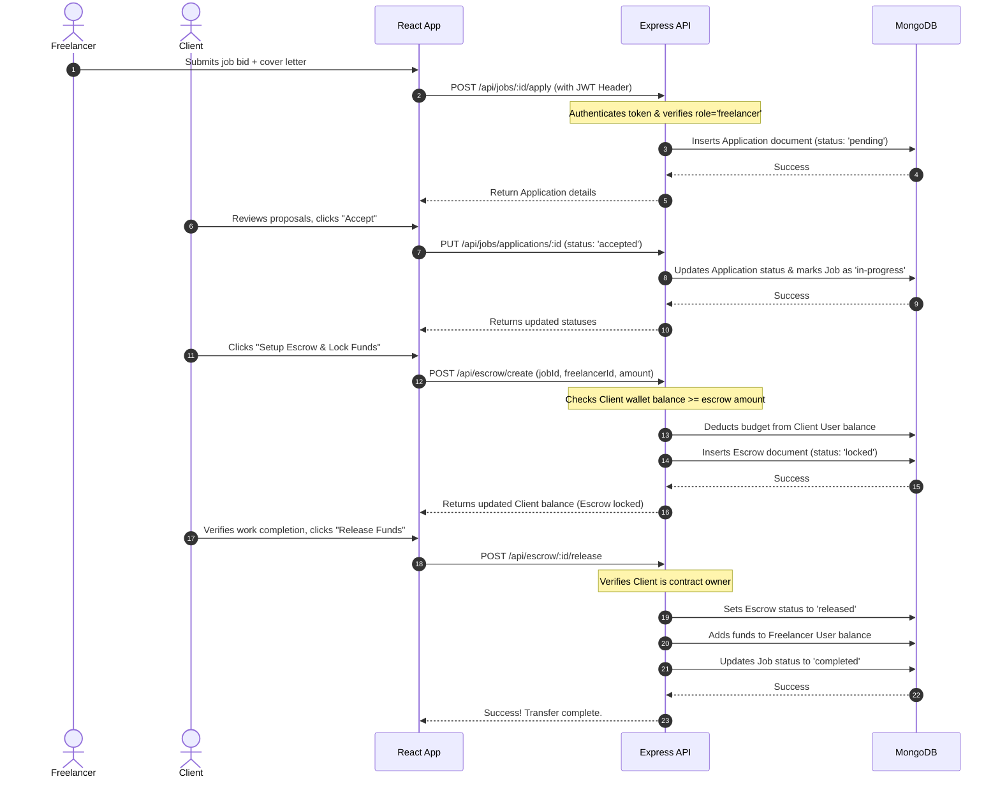

# MERN Escrow System for Freelancers: Complete Project Guide & Interview Preparation Manual

This manual provides a detailed, line-by-line explanation of your full-stack MERN (MongoDB, Express, React, Node.js) Escrow system. It is designed to help you understand every aspect of the codebase, prepare for university vivas, and ace job interviews.

---

## 1. Project Architecture & Directory Layout

The project is structured as a decoupled client-server application under `C:\Users\harin\OneDrive\Escrow System for Freelancers`.

```text
C:\Users\harin\OneDrive\Escrow System for Freelancers
├── package.json               # Root coordinator (concurrently runs client & server)
├── MONGODB_GUIDE.md           # Instructions on Atlas cluster setup
├── MERN_PROJECT_GUIDE.md      # This comprehensive project documentation
│
├── backend/                   # Node.js + Express + Mongoose Backend API
│   ├── .env                   # Sensitive configuration (Ports, MONGO_URI, JWT_SECRET)
│   ├── server.js              # Server entry point, DB seeding, Express routing mounts
│   ├── config/
│   │   └── db.js              # Mongoose database connection client
│   ├── middleware/
│   │   └── authMiddleware.js  # JWT validation & role-based access control (RBAC)
│   ├── models/                # Schema structures definitions
│   │   ├── User.js            # User accounts, hashing, simulated wallet balance
│   │   ├── Job.js             # Job postings database model
│   │   ├── Application.js     # Job bids & proposals database model
│   │   ├── Escrow.js          # Escrow contract ledger tracking locked/released status
│   │   └── Contact.js         # Client-support message ledger
│   ├── controllers/           # API request processors (Biz logic)
│   │   ├── authController.js
│   │   ├── jobController.js
│   │   ├── escrowController.js
│   │   └── contactController.js
│   └── routes/                # Endpoint address mappings to controllers
│       ├── authRoutes.js
│       ├── jobRoutes.js
│       ├── escrowRoutes.js
│       └── contactRoutes.js
│
└── frontend/                  # React.js SPA (Single Page Application) built using Vite
    ├── index.html             # HTML shell referencing main.jsx, Boxicons & Google Fonts
    ├── package.json           # Frontend packages (React Router, Dev server settings)
    └── src/
        ├── main.jsx           # React app renderer entrypoint
        ├── App.jsx            # Routing table maps URLs to pages
        ├── index.css          # Shared global stylesheets, custom card views, and badge classes
        ├── context/
        │   └── AuthContext.jsx # Global auth wrapper: logs login/register sessions
        ├── components/
        │   ├── Navbar.jsx     # Dynamic header bar (updates options on session roles)
        │   └── Footer.jsx     # Shared footer component
        └── pages/
            ├── Home.jsx       # Landing page showing features & dynamic database job list
            ├── Login.jsx      # SignIn card template calling AuthContext logins
            ├── SignUp.jsx     # Account creation with role configuration dropdowns
            ├── Contact.jsx    # Help form saving customer messages directly to DB
            ├── JobList.jsx    # Main page with category filters & Mongo live search
            ├── JobDetails.jsx # Explains requirements & opens custom cover letter modals
            ├── CreateJob.jsx  # Client interface to publish jobs
            └── Dashboard.jsx  # Double-column UI for managing balances & Escrow releases
```

---

## 2. Technology Stack Breakdown

The system is built on the **MERN Stack**:

| Component | Technology | Description |
| :--- | :--- | :--- |
| **M** | **MongoDB** | A NoSQL database that stores data as flexible BSON (JSON-like) documents. Highly scalable for platforms with evolving schemas (users, jobs, contracts). |
| **E** | **Express.js** | A light Node.js web server framework. It handles incoming REST HTTP requests (`GET`, `POST`, `PUT`, `DELETE`) and routes them to our backend logic. |
| **R** | **React.js** | A component-based frontend library. It handles dynamic rendering, UI updates, state checks, and navigation routes without requiring page reloads. |
| **N** | **Node.js** | A server-side JavaScript runtime environment. It executes JS code on the computer and hosts our Express server. |
| **Auth** | **JWT (JSON Web Tokens)** | Used for secure session management. When a user logs in, the server generates a signed cryptographical token which the browser saves and includes in the header of protected API requests. |
| **ODM** | **Mongoose** | Object Document Mapper for Node.js. It enforces schema structures, rules, and validators on top of MongoDB collections. |

---

## 3. End-to-End Workflow Diagram

Here is how data flows through the application during an Escrow cycle:



---

## 4. Pin-to-Pin Code Explanations

### A. The Core Database Schemas (Mongoose)

#### 1. User Schema (`backend/models/User.js`)
* **Role**: Defines the structure for user accounts.
* **Important Code Blocks**:
  * **Password Encryption Pre-hook**:
    ```javascript
    UserSchema.pre('save', async function (next) {
      if (!this.isModified('password')) { next(); }
      const salt = await bcrypt.genSalt(10);
      this.password = await bcrypt.hash(this.password, salt);
    });
    ```
    *Explanation:* This function runs automatically right before saving a user. It checks if the password was changed, generates a cryptographic salt, hashes the plain text password, and saves the hash. We never store plain text passwords in our database!
  * **Method matching password**:
    ```javascript
    UserSchema.methods.matchPassword = async function (enteredPassword) {
      return await bcrypt.compare(enteredPassword, this.password);
    };
    ```
    *Explanation:* Used during log in. It compares the entered password against the saved bcrypt hash and returns `true` if they match.
  * **Simulated Wallet Balance**:
    ```javascript
    balance: {
      type: Number,
      default: 5000, // Pre-funded with mock balance for testing
    }
    ```
    *Explanation:* Since this is an escrow project, each user starts with a pre-funded balance. Clients start with `$10,000` (seeded) or `$5,000` (default) to facilitate escrow locks.

#### 2. Escrow Ledger (`backend/models/Escrow.js`)
* **Role**: Tracks locked funds between clients and freelancers.
* **Schema Definition**:
  ```javascript
  const EscrowSchema = new mongoose.Schema({
    job: { type: mongoose.Schema.Types.ObjectId, ref: 'Job', required: true },
    client: { type: mongoose.Schema.Types.ObjectId, ref: 'User', required: true },
    freelancer: { type: mongoose.Schema.Types.ObjectId, ref: 'User', required: true },
    amount: { type: Number, required: true },
    status: {
      type: String,
      enum: ['locked', 'released', 'refunded', 'disputed'],
      default: 'locked',
    },
    createdAt: { type: Date, default: Date.now }
  });
  ```
  *Explanation:* Stores references (`ObjectIds`) to the respective `Job`, `Client`, and `Freelancer` accounts. The status starts as `'locked'` and changes to `'released'` when the client approves the work, or `'refunded'` if the contract is canceled.

---

### B. Secure Middlewares (JWT Authentication)

#### Authenticate & Extract Payload (`backend/middleware/authMiddleware.js`)
* **Role**: Blocks unauthorized users from calling private API routes (like posting jobs or releasing escrow).
* **Important Code**:
  ```javascript
  const protect = async (req, res, next) => {
    let token;
    if (req.headers.authorization && req.headers.authorization.startsWith('Bearer')) {
      try {
        token = req.headers.authorization.split(' ')[1];
        const decoded = jwt.verify(token, process.env.JWT_SECRET);
        req.user = await User.findById(decoded.id).select('-password');
        next();
      } catch (error) {
        res.status(401).json({ success: false, message: 'Not authorized, token failed' });
      }
    }
  };
  ```
  *Explanation:* It reads the `Authorization` header from the request. It splits `"Bearer <token>"` to isolate the JWT. Using `jwt.verify()`, it decrypts the token with our secret key. If valid, it fetches the user details from MongoDB (excluding password) and appends it to the `req` object as `req.user` so later controllers know exactly *who* made the request.

---

### C. Backend API Controllers

#### 1. Escrow Transactions (`backend/controllers/escrowController.js`)
* **Role**: Executes the core wallet deductions and transfers safely.
* **Important Code: Creating Escrow**:
  ```javascript
  exports.createEscrow = async (req, res) => {
    const { jobId, freelancerId, amount } = req.body;
    const client = await User.findById(req.user.id);
    
    if (client.balance < amount) {
      return res.status(400).json({ success: false, message: 'Insufficient balance' });
    }

    const escrow = await Escrow.create({
      job: jobId,
      client: req.user.id,
      freelancer: freelancerId,
      amount,
      status: 'locked'
    });

    client.balance -= amount;
    await client.save();
    
    // Updates job state to 'in-progress'
    await Job.findByIdAndUpdate(jobId, { status: 'in-progress' });
  };
  ```
  *Explanation:* Verifies the client has enough funds in their wallet balance. It creates the locked escrow contract, subtracts the money from the client's balance immediately, and sets the job to `in-progress`.
* **Important Code: Releasing Escrow**:
  ```javascript
  exports.releaseEscrow = async (req, res) => {
    const escrow = await Escrow.findById(req.params.id);
    if (escrow.client.toString() !== req.user.id) {
      return res.status(403).json({ message: 'Unauthorized' });
    }
    
    escrow.status = 'released';
    await escrow.save();

    const freelancer = await User.findById(escrow.freelancer);
    freelancer.balance += escrow.amount;
    await freelancer.save();

    await Job.findByIdAndUpdate(escrow.job, { status: 'completed' });
  };
  ```
  *Explanation:* Checks that the client calling the API is the one who funded the escrow. It updates the escrow status to `'released'`, moves the locked funds directly into the freelancer's balance, and marks the job status as `'completed'`.

---

### D. Frontend State & Navigation (React)

#### 1. Authentication State Provider (`frontend/src/context/AuthContext.jsx`)
* **Role**: Makes user details available to all pages in the app (so the Navbar can show the name, and pages can inspect the role).
* **Important Code**:
  ```javascript
  export const AuthProvider = ({ children }) => {
    const [user, setUser] = useState(null);
    const [token, setToken] = useState(localStorage.getItem('token') || '');

    const login = async (email, password) => {
      const res = await fetch(`${API_URL}/auth/login`, {
        method: 'POST',
        headers: { 'Content-Type': 'application/json' },
        body: JSON.stringify({ email, password })
      });
      const data = await res.json();
      if (data.success) {
        localStorage.setItem('token', data.token);
        setToken(data.token);
        setUser(data.user);
      }
    };
  };
  ```
  *Explanation:* React handles state inside memory. By wrapping our application in `AuthContext.Provider`, any page component can access the active `user` object and `token` variables. On successful login, the JWT is stored inside `localStorage` so the session survives browser refreshes.

#### 2. The Main Interactive Center (`frontend/src/pages/Dashboard.jsx`)
* **Role**: A dashboard tailored to the user's role:
  * **For Clients**: Fetches jobs they created. Highlights freelancer applications. Let's them accept proposals, fund escrow, and click **Release Funds** or **Request Refund**.
  * **For Freelancers**: Displays jobs they bid on and incoming escrow contracts. Shows earnings locked in escrow.

---

## 5. Viva / Interview Questions Bank (With Model Answers)

Here are the questions interviewers or external examiners are most likely to ask about this project:

### Category A: Architecture & General MERN

#### Q1: Why did you choose the MERN stack over standard HTML/CSS/PHP or client-only architectures?
* **Model Answer:**
  > *"Choosing MERN allowed me to build a modern, scalable Single Page Application (SPA). Instead of refreshing pages on every request like PHP, React handles updates dynamically inside the virtual DOM for a fast, desktop-like user experience. MongoDB provides a flexible, schema-less structure that fits changing job descriptions, bids, and contracts. Express and Node.js give me a unified JavaScript language stack from front to back, maximizing development efficiency."*

#### Q2: How does the frontend communicate with the backend?
* **Model Answer:**
  > *"The frontend communicates with the backend asynchronously using standard HTTP REST APIs. I use the browser's native `fetch()` method. The backend Express API acts as a data provider, returning responses in JSON format. The frontend then parses this JSON and updates its state, causing React to render changes dynamically."*

#### Q3: Where are the static files and the index.html served in this project?
* **Model Answer:**
  > *"During development, Vite compiles the React files and serves them from a local development server on port `5173`. The backend Express server runs independently on port `5000`. For production deployment, we would compile the React app into optimized static build assets using `npm run build` and configure Express to serve those static files directly using `express.static()`."*

---

### Category B: Security & Authentication

#### Q4: How is User Authentication managed in your application?
* **Model Answer:**
  > *"Authentication is managed using **JSON Web Tokens (JWT)** and password hashing. When a user registers or logs in, the backend hashes/verifies the password using `bcryptjs`. On a successful check, the server generates a unique JWT signed with a secret key and returns it to the client. The frontend stores this token in `localStorage`. For any subsequent request to protected routes, the frontend attaches this token as a `Bearer` header in the `Authorization` request metadata."*

#### Q5: What is a JWT and how does the server verify it?
* **Model Answer:**
  > *"A JWT consists of three parts: a Header (algorithm info), a Payload (user ID, expiration), and a Signature. The signature is created by hashing the header and payload with a private secret key stored only on the server. When the server receives the token, it hashes the header and payload again using its secret key. If the resulting hash matches the signature, the server trusts the token payload and grants access."*

#### Q6: How do you protect passwords in your database?
* **Model Answer:**
  > *"We never save passwords in plain text. In our Mongoose user schema, we have a pre-save hook that intercepts the user document before it writes to the database. It uses `bcryptjs` to generate a random salt and compute a secure one-way hash of the password. Even if our database were breached, the plain text passwords cannot be decrypted."*

#### Q7: What is Role-Based Access Control (RBAC) and how did you implement it?
* **Model Answer:**
  > *"RBAC restricts API routes based on a user's role. In my project, users can be either a `client` or a `freelancer`. I wrote an authorization middleware on the backend:
  > ```javascript
  > const authorize = (...roles) => {
  >   return (req, res, next) => {
  >     if (!roles.includes(req.user.role)) {
  >       return res.status(403).json({ message: 'Forbidden' });
  >     }
  >     next();
  >   };
  > };
  > ```
  > This allows me to easily secure routes, ensuring only client accounts can post new jobs or release funds."*

---

### Category C: Database & Mongoose

#### Q8: What is Mongoose and why did you use it instead of the native MongoDB driver?
* **Model Answer:**
  > *"Mongoose is an Object Document Mapper (ODM) for MongoDB. MongoDB is schema-less by default, which can lead to unstructured data. Mongoose allows us to define rigid schema structures, validation rules, default parameters, and relational references (using `ObjectId` refs). It also gives us query helper methods like `.populate()` to easily perform join-like operations."*

#### Q9: How do you link the User collection with the Job collection in your code?
* **Model Answer:**
  > *"In the `JobSchema` in `models/Job.js`, I added a field named `client` which holds a mongoose reference to the `User` schema:
  > ```javascript
  > client: {
  >   type: mongoose.Schema.Types.ObjectId,
  >   ref: 'User',
  >   required: true
  > }
  > ```
  > When I query the database, I can use `.populate('client', 'firstName lastName email')` which tells Mongoose to automatically fetch the matching user document and replace the ObjectId with the actual user details before returning the result."*

#### Q10: How do filters and search work on the "Find Jobs" page database query?
* **Model Answer:**
  > *"They are processed on the database side using query parameter selectors in the `GET /api/jobs` controller. If a search string is sent, we use a regular expression query:
  > `query.$or = [{ title: { $regex: search, $options: 'i' } }, ...]`
  > If a category type is selected (e.g. `freelancer`, `partTime`), we append `{ type: type }` to the filter criteria. This ensures that the database only returns records that match both parameters, saving bandwidth."*

---

### Category D: The Escrow Payment Mechanics

#### Q11: Explain how the Escrow Payment system is implemented in your code.
* **Model Answer:**
  > *"The escrow payment system is implemented as a **secure double-entry ledger** using database documents and user wallet balances:
  > 1. **Setup & Lock:** When a client accepts a freelancer, they initiate an Escrow. The backend checks if the client's wallet balance is sufficient, deducts the contract amount from their balance, and creates an `Escrow` document with the status `'locked'`.
  > 2. **Verification & Release:** The funds remain locked in the escrow ledger. Once the client approves the work, they call the release API. The backend updates the escrow status to `'released'` and adds the funds to the freelancer's wallet balance.
  > 3. **Refund:** If a project fails or is canceled, the client can request a refund. The backend marks the escrow as `'refunded'` and returns the locked amount to the client's wallet balance."*

#### Q12: How do you prevent double-spending or race conditions in the escrow transactions?
* **Model Answer:**
  > *"In a production application, we would use **database transactions (sessions)** in MongoDB. This ensures that the wallet deduction, escrow document insertion, and job status update occur as a single atomic operation. If any step fails, the entire transaction rolls back. In my current code, I check balances before performing any state change and verify that the escrow is in the `'locked'` state before permitting a release or refund, preventing double-release bugs."*

#### Q13: What happens to the job listing status during the Escrow cycle?
* **Model Answer:**
  > *"The job status acts as a state machine:
  > * It starts as `'open'` when created, making it visible on the 'Find Jobs' page.
  > * When a bid is accepted and the escrow is funded, the status changes to `'in-progress'`, which filters it out of the public listings.
  > * When the client releases the funds, the status becomes `'completed'`.
  > * If the client refunds the escrow, the status is reverted to `'open'` so other freelancers can apply."*

---

## 6. How to Export this Manual to a PDF

You can easily convert this Markdown document into a PDF to print or study offline:

1. **Install Markdown PDF Extension in VS Code**:
   * Open VS Code, press `Ctrl+Shift+X` (Extensions).
   * Search for **"Markdown PDF"** (by yzane) and click **Install**.
2. **Export to PDF**:
   * Open this file `MERN_PROJECT_GUIDE.md` in VS Code.
   * Right-click inside the editor window.
   * Select **"Markdown PDF: Export (pdf)"**.
   * A styled PDF will be generated inside the project folder.
